# ha-maintenance

[](https://www.home-assistant.io/integrations/marketplace/)
[](https://github.com/juju35/ha-maintenance/actions/workflows/hacs.yml)
[](https://github.com/juju35/ha-maintenance/actions/workflows/validate.yml)
[](https://github.com/juju35/ha-maintenance/actions/workflows/lint.yml)
[](https://github.com/juju35/ha-maintenance/releases/latest)
[](https://github.com/juju35/ha-maintenance/blob/main/LICENSE)
[](https://buymeacoffee.com/julienstep9)

<p align="center">
  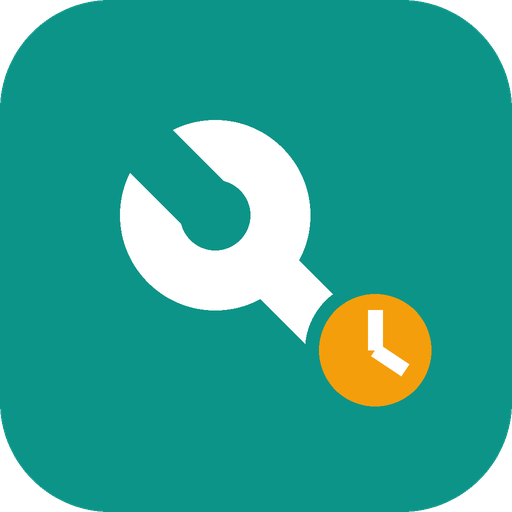
</p>

Home Assistant integration for the **household maintenance**: the consumables of your devices — vacuum brushes and filters, purifier filters, printer ink and toner — are **found by themselves** among their sensors, and your **recurring chores** (descaling, smoke detector tests, boiler service…) are added in a couple of clicks. Everything gets a due date, the most urgent first, with a daily reminder, a calendar, a history, a sidebar **panel** and a Lovelace **card**.

[](https://my.home-assistant.io/redirect/marketplace_repository/?owner=juju35&repository=ha-maintenance&category=integration)

| Card | Something overdue |
|---|---|
| 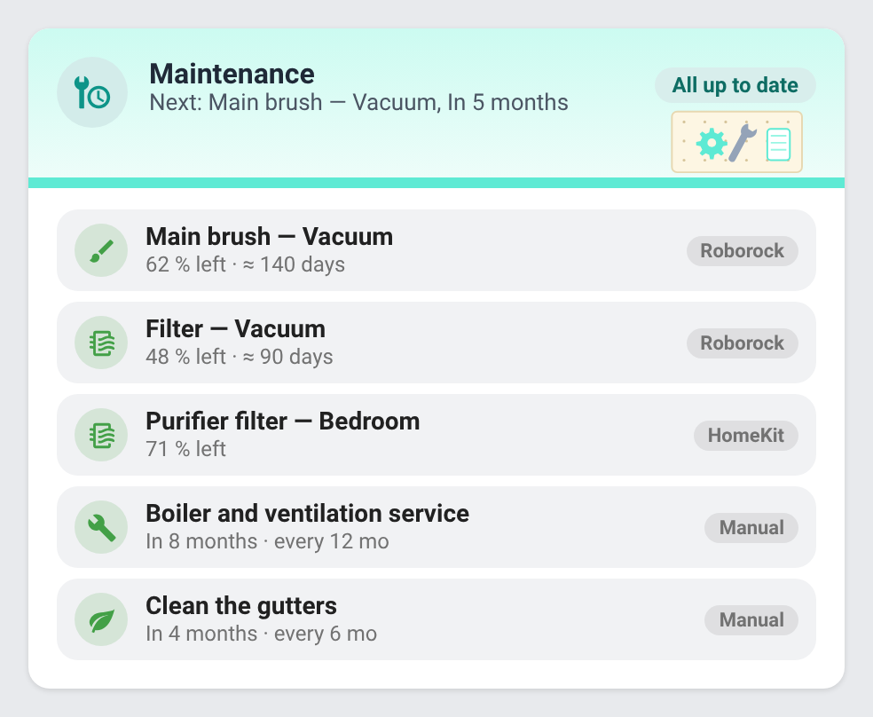 | 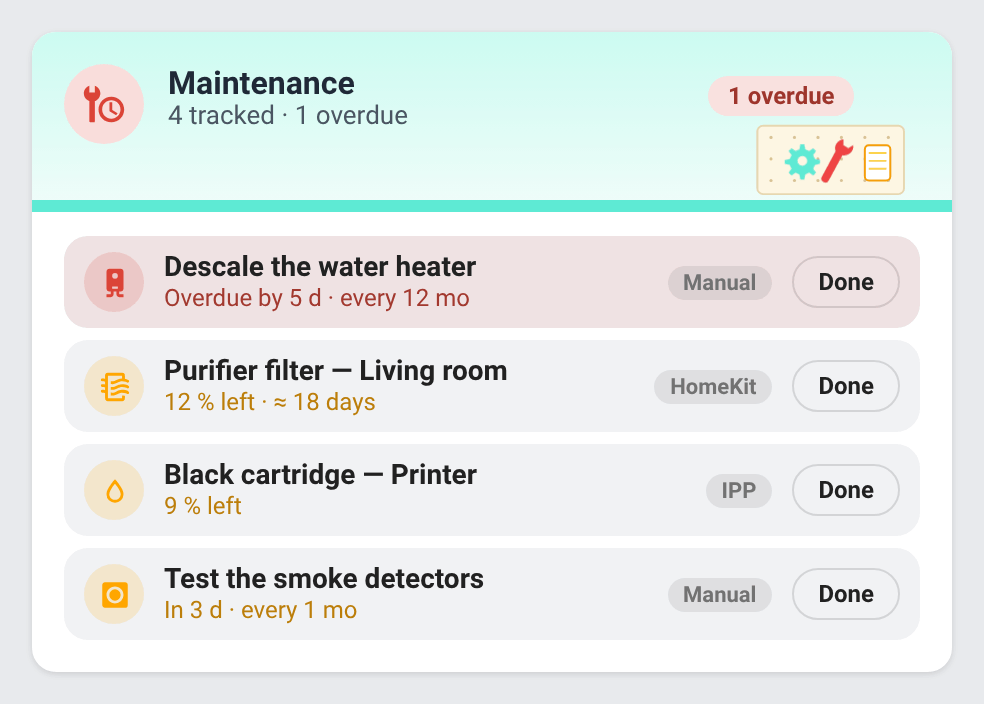 |

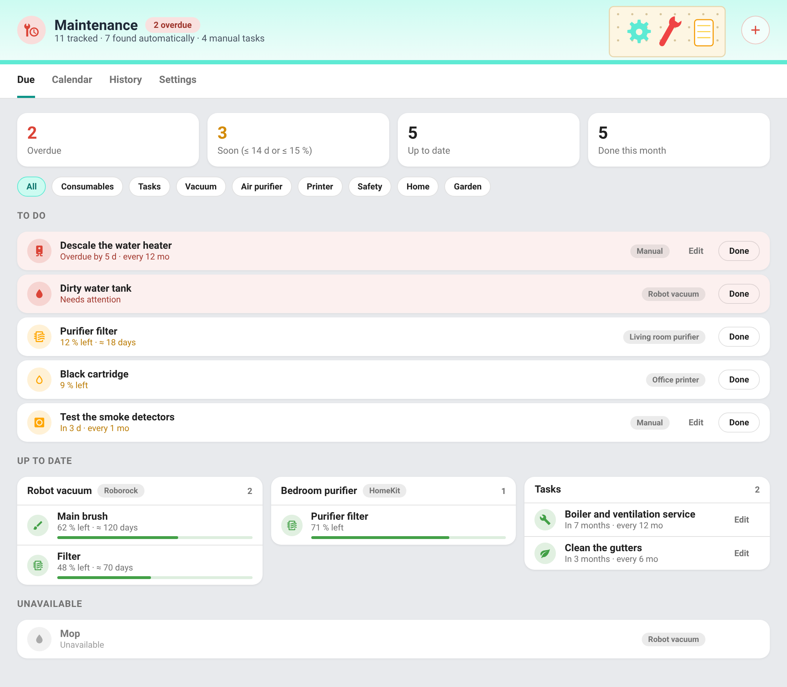

## Features

- **Consumables found automatically** — any sensor whose name says what it is (filter, brush, mop, ink, toner, cartridge, drum…) and whose unit says how much is left (a percentage, or a time left in hours), plus the problem binary sensors of tanks and liquids (clean water empty, dirty water full, cleaning fluid…); found from the entity's translation key too, so it works whatever the language Home Assistant runs in; battery, signal and air-quality sensors are left out
- **Days left estimated** from one sample a day, so a filter at 12 % shows "≈ 18 days" at its current pace
- **Done** presses the device's own **reset button** when it has one (Roborock, Xiaomi…), and keeps a line in the history
- **Manual tasks** every N days, weeks or months, from the last time they were done, in categories (home, safety, garden, vehicle…)
- **Statuses** — overdue, soon (within 14 days or at 15 % by default) and up to date, most urgent first
- **Daily reminder** of what became overdue or soon, each item once, through any notify action or [Notify Hub](https://github.com/juju35/ha-notify-hub)
- **Calendar** entity with the due dates (and the next occurrences of the tasks)
- **Panel** (administrators) — Due (filters, Done, the task editor), Calendar (the next 30 days), History, Settings (thresholds, reminders, the consumables tracked); a red badge on the sidebar entry while something is overdue
- **Card** — the items most urgent first with the Done button, under an animated illustrated header, light and dark
- **Sensors** — overdue, due soon, tracked
- 22 languages

## Supported integrations

Maintenance reads the consumable sensors that other integrations create. It recognises, among others:

- [Roborock](https://www.home-assistant.io/integrations/roborock/) — main brush, side brush, filter, sensors and dock strainer time left, with their reset buttons; dock clean water, dirty water and cleaning fluid
- [Xiaomi Miio](https://www.home-assistant.io/integrations/xiaomi_miio/) — vacuum consumables and purifier filter life
- [Ecovacs](https://www.home-assistant.io/integrations/ecovacs/) — brushes and filter lifespan
- [HomeKit Device](https://www.home-assistant.io/integrations/homekit_controller/) — purifier filter life level
- [Internet Printing Protocol (IPP)](https://www.home-assistant.io/integrations/ipp/) — ink and toner levels
- [Brother Printer](https://www.home-assistant.io/integrations/brother/) — toner and drum remaining

Any other integration whose sensors follow the same naming works too; a sensor can be left out in the panel's settings.

## Prerequisites

- Home Assistant 2024.12 or later

## Installation

### Via the Marketplace (recommended)

Click the button below to add the repository directly:

[](https://my.home-assistant.io/redirect/marketplace_repository/?owner=juju35&repository=ha-maintenance&category=integration)

Then click **Install** and restart Home Assistant.

Or manually:

1. Open **Settings → Marketplace → Add from link** (top right; this needs a GitHub account connected)
2. Add `https://github.com/juju35/ha-maintenance` — Type: **Integration**
3. Open **Maintenance** and click **Install**
4. Restart Home Assistant

The card is **part of the integration**: at startup it is added to the dashboard resources (`/maintenance_static/maintenance-card.js`, module). After an install or an update, restart Home Assistant and refresh the browser (clear the companion app cache if needed).

If your dashboards are in YAML mode, the card is loaded on every page without going through the resources.

### Manual

Copy `custom_components/maintenance/` to `/config/custom_components/maintenance/`, then restart Home Assistant.

## Configuration

### Integration

**Settings → Devices & services → Add integration → Maintenance**. One instance, nothing to fill in. The **Maintenance** panel appears in the sidebar (administrators); the thresholds and the reminder can also be changed from the integration's **Configure** button.

### Actions

```yaml
action: maintenance.add_task
data:
  name: Descale the water heater
  every: 12
  unit: months          # days, weeks or months
  last_done: "2026-05-01"   # optional: today when left out
  category: home        # optional
  icon: mdi:water-boiler    # optional
```

| Action | What it does |
|---|---|
| `maintenance.done` | Marks an item done (`item`: a consumable's sensor or `task:…`); returns the time |
| `maintenance.add_task` | Adds a manual task; returns its `item` id |
| `maintenance.remove_task` | Removes a manual task |

Each Done also fires a `maintenance_done` event.

### Entities

One device, **Maintenance**, with (named in Home Assistant's language):

| Entity | What it shows |
|---|---|
| Overdue (sensor) | Items overdue (its attributes carry the card's data) |
| Due soon (sensor) | Items due soon |
| Tracked (sensor) | Items tracked |
| Due dates (calendar) | Due dates of the tasks and the consumables |

### Card

```yaml
type: custom:maintenance-card
```

Every option is in the visual editor.

| Option | Default | Description |
|---|---|---|
| `title` | `Maintenance` | Header title |
| `rows` | `5` | Items shown (1–10) |
| `illustration_theme` | `auto` | Header illustration: `auto` (follows the theme), `day` or `night` |
| `entity` | found | The integration's *Overdue* sensor (found by itself) |
| `language` | Home Assistant's | Force another language |

## Screenshots

### Card

| Light | Dark |
|---|---|
| 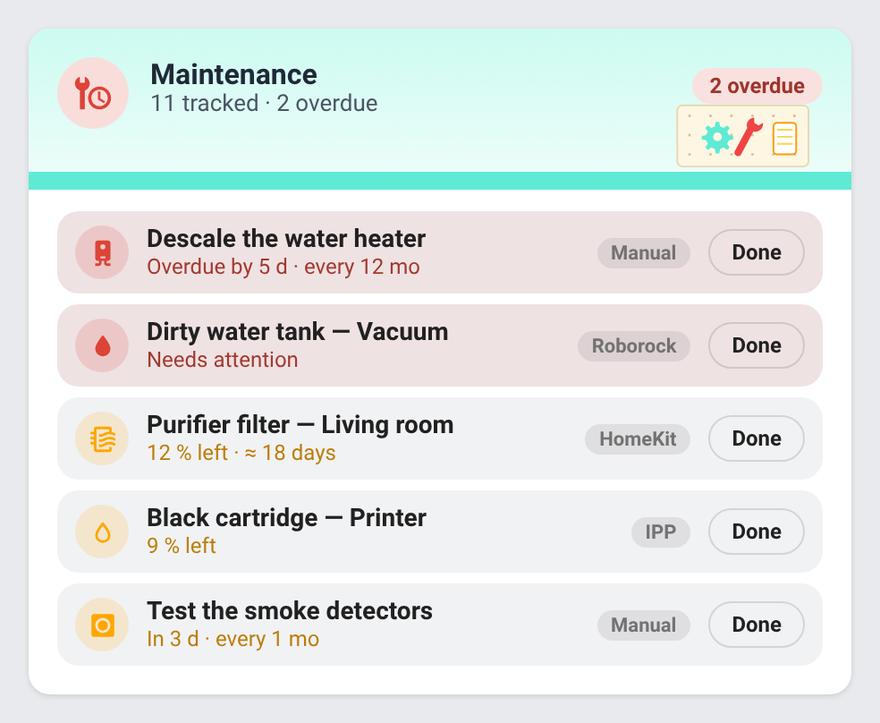 | 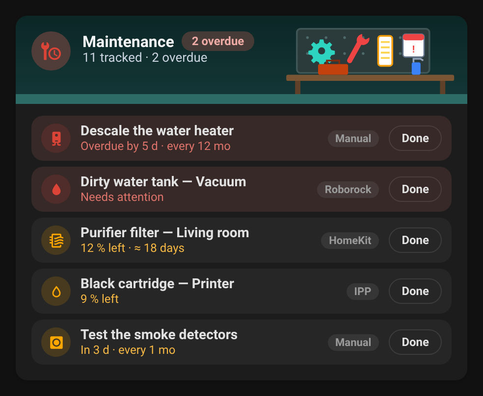 |
|  | 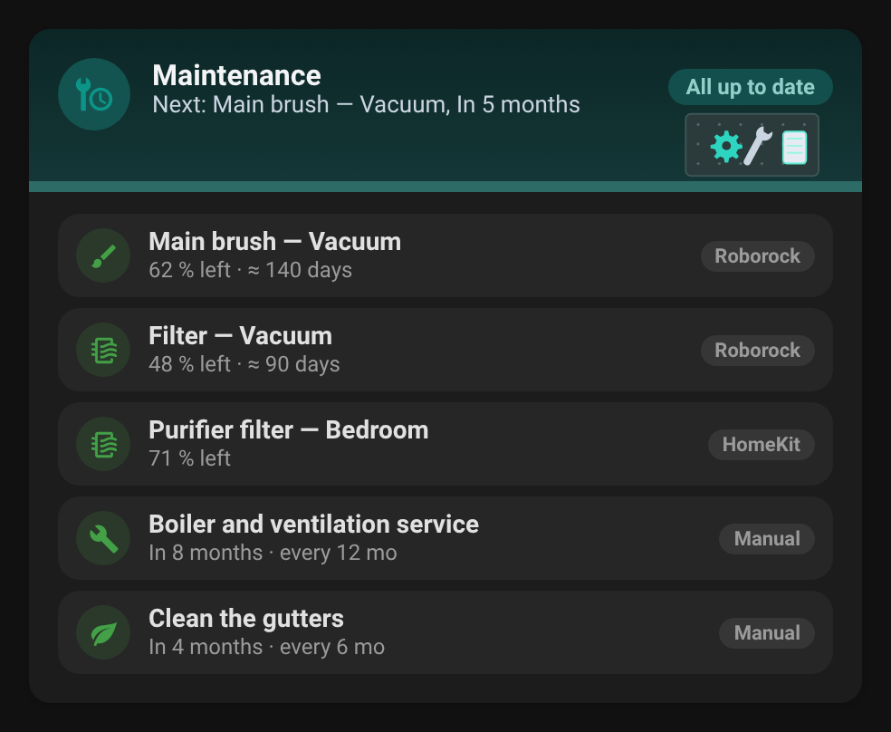 |

### Panel

| Tab | Light | Dark |
|---|---|---|
| Due |  | 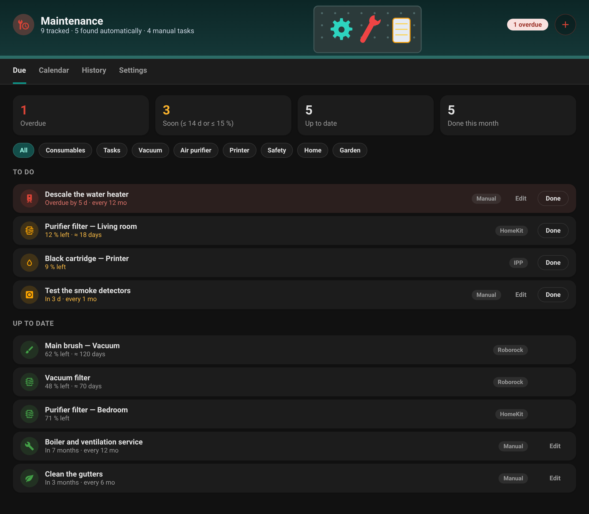 |
| Calendar | 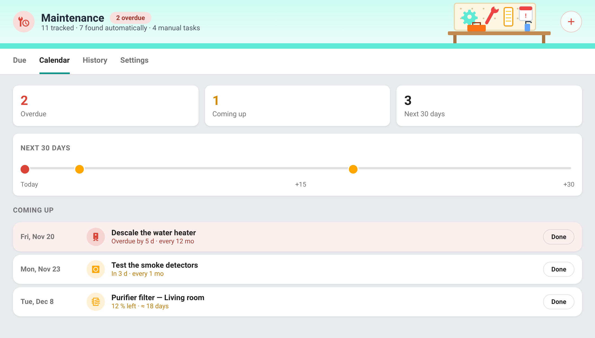 | 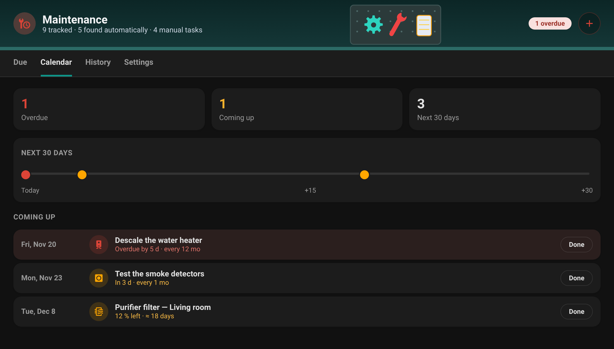 |
| History | 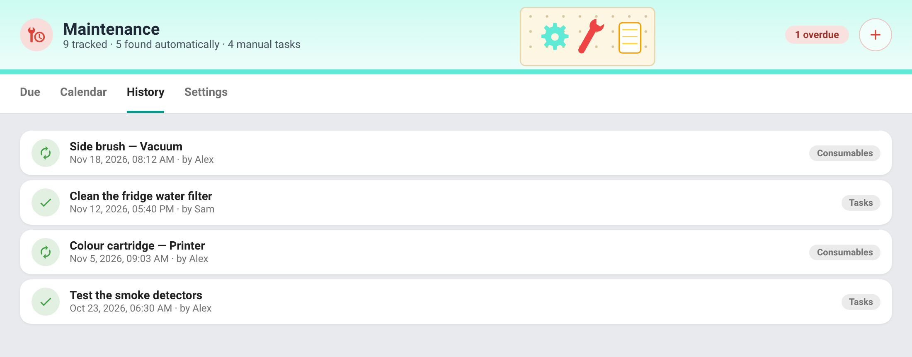 | 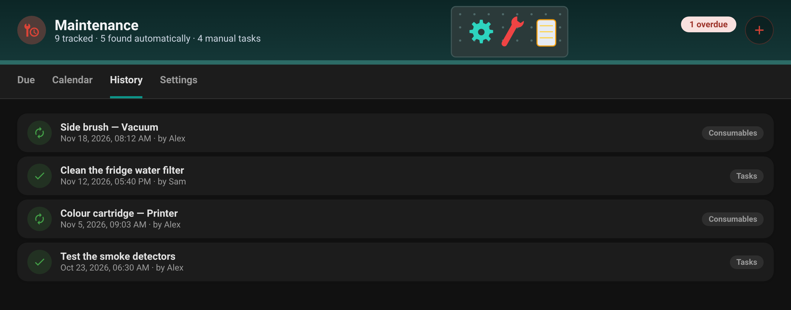 |
| Settings | 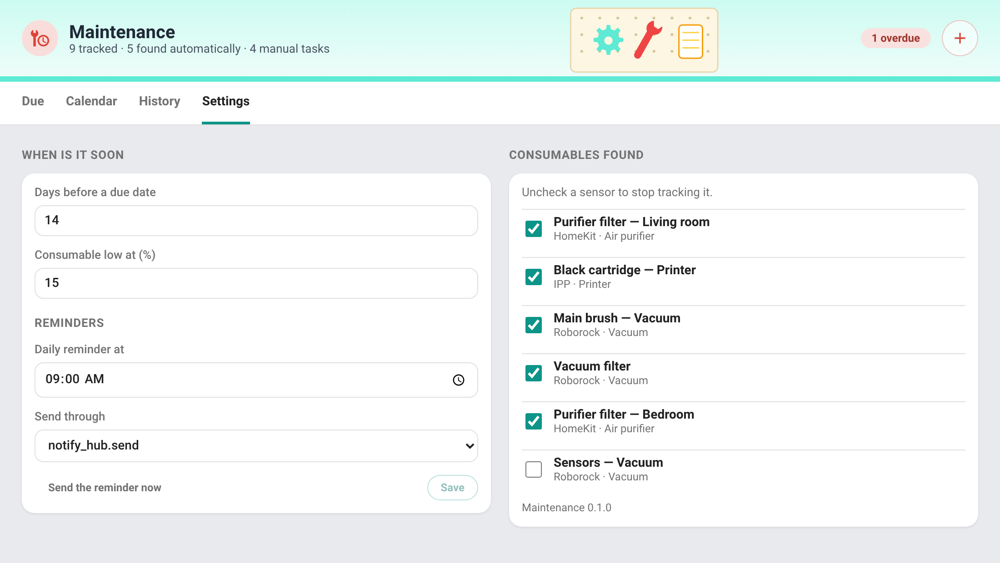 | 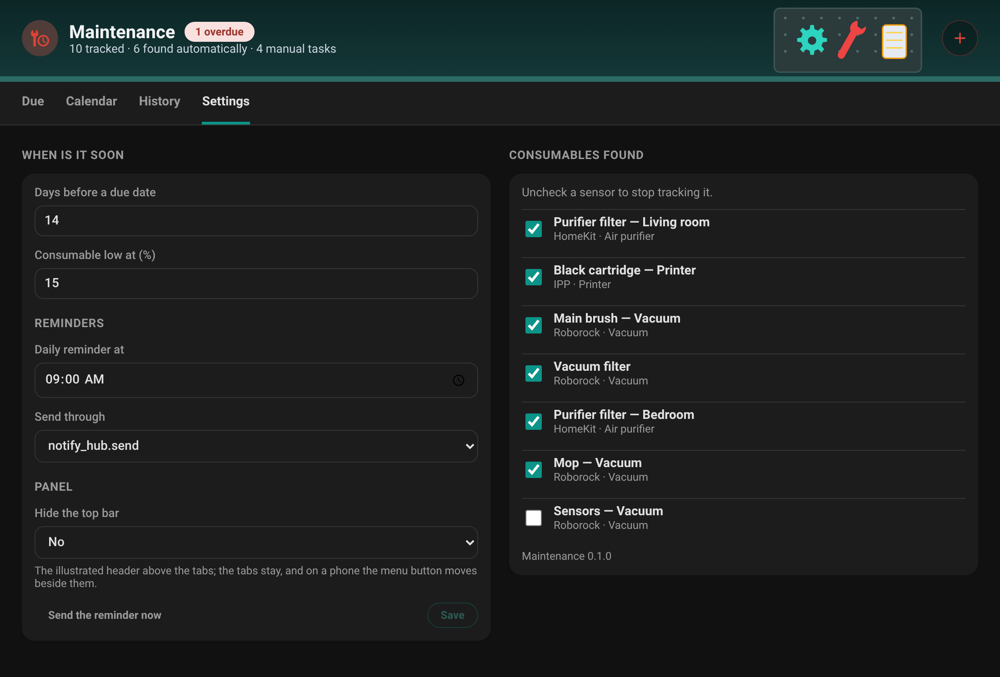 |

## How it works

1. Every hour (and at startup), the sensors are scanned for consumables; each one is sampled once a day.
2. A consumable is **overdue** when empty, **soon** at or below the percentage threshold or when its estimated days left fall within the days threshold.
3. A task is due its interval after the last time it was done: **overdue** past that date, **soon** within the days threshold.
4. At the reminder time, what became overdue or soon since the last reminder is sent once.

## Development

```bash
pip install -r requirements_test.txt && pytest
npm install --no-save acorn@8.19.0 && node scripts/split-frontend.mjs --check   # the translation split the release makes
pip install playwright pillow && playwright install chromium
python scripts/screenshots.py    # renders the stills and the GIF (needs ffmpeg) into screenshots/
```

### Releasing

1. Bump the version in `custom_components/maintenance/manifest.json`
2. Add a `## <version>` section at the top of [CHANGELOG.md](https://github.com/juju35/ha-maintenance/blob/main/CHANGELOG.md)
3. Push to `main`: the **Release** workflow creates the tag and the GitHub release with the changelog section as notes

## Translations

The integration, the panel and the card follow the language of Home Assistant (the card's `language` option can force another one). In the release, the card file keeps English only; each other language is a small file next to it, loaded when needed. Currently supported:

| Language | Code |
|---|---|
| English | `en` |
| Français | `fr` |
| Deutsch | `de` |
| Español | `es` |
| Српски | `sr` |
| Srpski (latinica) | `sr-Latn` |
| Italiano | `it` |
| Nederlands | `nl` |
| Português (Portugal) | `pt` |
| Polski | `pl` |
| Română | `ro` |
| Dansk | `da` |
| Svenska | `sv` |
| Български | `bg` |
| Русский | `ru` |
| Українська | `uk` |
| Magyar | `hu` |
| Slovenčina | `sk` |
| Čeština | `cs` |
| Slovenščina | `sl` |
| Latviešu | `lv` |
| Ελληνικά | `el` |

Brazilian Portuguese (`pt-BR`): pt-BR uses the European Portuguese texts.

Contributions for additional languages are welcome!

## License

[MIT](https://github.com/juju35/ha-maintenance/blob/main/LICENSE)

## Support

If you find this project useful, you can support its development:

<a href="https://buymeacoffee.com/julienstep9"></a>
